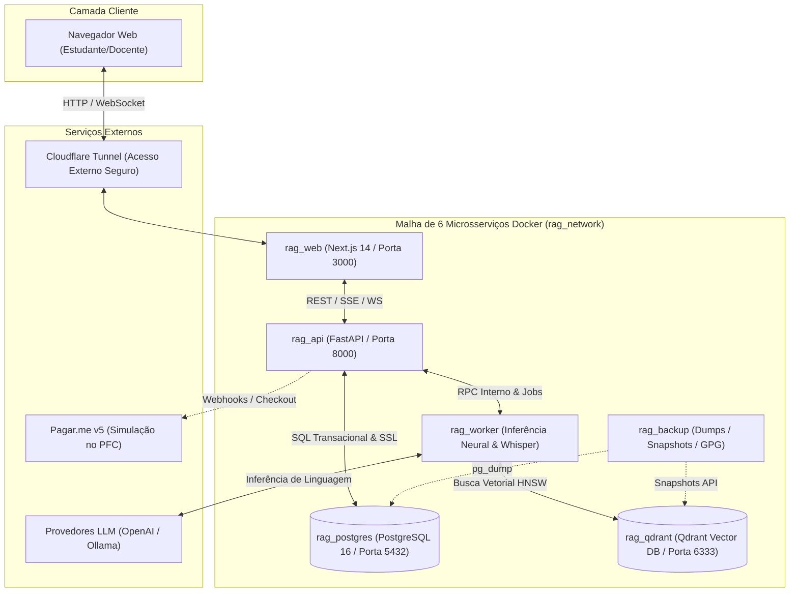

# MentorIA — Plataforma Educacional Inteligente com RAG e Agentes

[](https://app.codecov.io/github/unipfc/mentoria)
[](https://github.com/unipfc/mentoria)
[](https://www.python.org/)
[](https://fastapi.tiangolo.com/)
[](https://nextjs.org/)
[](https://www.postgresql.org/)
[](https://qdrant.tech/)

## Visão Geral

O **MentorIA** é uma plataforma SaaS (Software as a Service) educacional de mentoria socrática baseada em **RAG (Retrieval-Augmented Generation)** avançado. A aplicação soluciona o problema de alucinações e respostas imprecisas de modelos generativos de inteligência artificial, ancorando todas as explicações conceituais em materiais didáticos, apostilas e bancos de questões homologados e indexados por disciplina acadêmica.

Este projeto consolida o **Projeto Final de Curso II (PFC II)** em Engenharia / Ciência da Computação, contemplando arquitetura de microsserviços em contêineres Docker, esteira de testes automatizados com 98% de cobertura, rigorosos mecanismos de segurança cibernética (2FA TOTP, hashing com pepper, AES-256-GCM), transcrição de áudio local com Faster-Whisper, bilhetagem de tokens e conformidade integral com a **LGPD (Lei Geral de Proteção de Dados)**.

---

## Funcionalidades Principais (Features)

### 1. Inteligência Artificial e Pipeline RAG em Cinco Estágios
* **Pipeline RAG Especializado:**
  1. *Contextualização de Mensagem:* Substituição dinâmica de termos anafóricos e pronomes pelo histórico recente de conversa.
  2. *Expansão de Consulta:* Geração de sinônimos técnicos e variações semânticas para ampliar a abrangência de recuperação.
  3. *Busca Densa Vetorial:* Recuperação dos dez fragmentos didáticos mais relevantes no **Qdrant** por similaridade de cosseno ($k=10$).
  4. *Re-ranqueamento Semântico (Reranking):* Classificação par a par com modelo Cross-Encoder (`mmarco-mMiniLMv2-L6-H384-v1`), selecionando os cinco melhores trechos ancorados.
  5. *Síntese Socrática e Streaming:* Geração de resposta reflexiva transmitida em fluxo contínuo via Server-Sent Events (SSE).
* **Modelos de Embeddings Híbridos:** Suporte a embeddings locais de alta precisão com `BAAI/bge-m3` (1024 dimensões) e OpenAI `text-embedding-3-small`.
* **Provedores de Linguagem Flexíveis:** Suporte multi-provedor (OpenAI `gpt-4o-mini`, `gpt-5-nano`, `gpt-5.6-luna`, `gpt-4.1-mini` e Ollama local `llama3.1:8b`), com compatibilidade automática para parâmetros de modelos de raciocínio (`max_completion_tokens`).
* **Respostas Instantâneas Determinísticas (< 5 ms):** Interceptação de saudações e comandos frequentes por normalização Unicode NFKD, entregando respostas imediatas com consumo zero de tokens.
* **Geração Automática de Títulos:** Sumarização e titulação inteligente da sessão de chat em segundo plano a partir da primeira dúvida enviada pelo estudante.
* **Transcrição de Voz Local (Faster-Whisper):** Reconhecimento de áudio local em língua portuguesa via modelo neural `faster-whisper-small` (runtime CTranslate2 com quantização `int8` e VAD), permitindo perguntas por voz com total privacidade e sem custos de APIs externas.

### 2. Bilhetagem e Orçamento de Tokens
* **Contagem Preditiva em Milissegundos:** Tokenizador baseado no **Tiktoken** (`o200k_base` e `cl100k_base`) com cache LRU em memória.
* **Tiers e Cotas de Consumo:** Níveis escalonados de acesso (`LEVEL_01` a `LEVEL_05`) com monitoramento gráfico em tempo real e bloqueio preventivo de inferência ao atingir a cota do usuário.

### 3. Autenticação e Segurança Cibernética em Profundidade
* **Proteção Criptográfica de Senhas:** Mitigação da limitação de 72 bytes do Bcrypt por meio da aplicação prévia de `SHA-256 + Pepper Corporativo Estático + Base64 + Bcrypt (12 rounds)`.
* **Autenticação em Dois Fatores (2FA TOTP):** Suporte nativo ao padrão RFC 6238 via aplicativos móveis (Google Authenticator, Microsoft Authenticator) com chaves em Base32 e geração de QR Code.
* **Cookies Seguros e Rotação de Tokens:** Autenticação baseada em cookies `HttpOnly` com proteção contra CSRF, cabeçalhos de segurança HTTPS e rotação contínua de refresh tokens.
* **Criptografia em Repouso (AES-256-GCM):** Segredos e chaves de 2FA armazenados no banco relacional são cifrados simetricamente com chave mestra derivada via PBKDF2 (100.000 iterações).
* **Auditoria e Detecção de Anomalias (`SecurityCache`):** Rastreamento de acessos em cache persistente (`cache/security/`), detectando automaticamente ataques de *Credential Stuffing* (5+ usuários por IP), *IP Hopping* (3+ IPs por conta) e bloqueio automático após 15 falhas consecutivas, com purga periódica a cada 24 horas.
* **Segurança de Microsserviços:** Políticas de borda SEC-01 (autenticação estrita e limite de 15 MB para arquivos de áudio) e SEC-02 (chave de API interna para comunicação privada com o worker neural).
* **Conexões Criptografadas no Banco:** Imposição estrita de SSL/TLS nas sessões com o PostgreSQL.

### 4. Conformidade Legal (LGPD) e Privacidade
* **Consentimento Registrado:** Aceite formal e versionado dos Termos de Uso e Política de Privacidade armazenado no banco (`terms_accepted_at`).
* **Portabilidade de Dados Pessoais:** Exportação instantânea em formato estruturado JSON (`/auth/me/export`) contendo perfil, histórico de conversas e transações.
* **Direito ao Esquecimento:** Exclusão definitiva de conta (`/auth/me/delete-account`) com verificação em duas etapas por token único enviado ao e-mail cadastrado, disparando deleção transacional em cascata (PostgreSQL CASCADE) e purga dos fragmentos no Qdrant.
* **Chats Somente Leitura:** Travamento automático de sessões antigas (`is_read_only`) caso a base de conhecimento de origem sofra restrições ou remoção.

### 5. Monetização e Gateway de Pagamentos
* **Integração Pagar.me v5:** Estrutura completa de checkout hospedado e tratamento assíncrono de webhooks para assinaturas recorrentes e recargas de créditos.
* **Escopo Acadêmico do PFC II:** Todo o código de cobrança está plenamente implementado, operando com simulação transacional controlada (`SKIP_PAYMENT=True`) por dispensar requisitos burocráticos de pessoa jurídica (CNPJ) e conta bancária empresarial no âmbito de um projeto acadêmico de graduação.

### 6. Interface Web Moderna (Frontend)
* **Single Page Application em Next.js 14:** Desenvolvida sobre React 18, TypeScript 5 e Tailwind CSS no modelo App Router.
* **Renderização Matemática e Código com KaTeX:** Suporte dinâmico a fórmulas matemáticas inline (`$...$`) e em destaque (`$$...$$`) via KaTeX compilado sem quebras durante o recebimento de respostas em streaming.
* **Resiliência de Sessão (Axios Interceptor):** Fila de espera concorrente para renovação automática de token expirado (401 via `/auth/refresh`) sem desconectar o usuário.
* **Atualizações em Tempo Real:** Conexões bidirecionais via WebSockets para acompanhamento de tarefas de ingestão e indicadores de status.

---

## Arquitetura do Sistema

A solução adota arquitetura de **Microsserviços Containerizados** gerenciados por um arquivo [`docker-compose.yml`](docker-compose.yml), isolando seis serviços na rede privativa `rag_network`:

1. **`rag_web` (Frontend):** Servidor Next.js 14 / Node.js (porta 3000), entregando a aplicação cliente responsiva.
2. **`rag_api` (API Gateway):** Servidor assíncrono em FastAPI / Python 3.12 (porta 8000), responsável por autenticação, rotas REST, regras de negócio e despacho de tarefas.
3. **`rag_worker` (AI Worker):** Serviço desacoplado para inferência neural pesada, carregamento de modelos locais (BGE-M3, Faster-Whisper, Cross-Encoder) e ingestão de documentos.
4. **`rag_postgres` (Banco Relacional):** **PostgreSQL 16** (porta 5432) com volume persistente `pgdata`, gerenciando dados cadastrais, mensagens e metadados com migrações Alembic.
5. **`rag_qdrant` (Banco Vetorial):** Motor Qdrant em Rust (porta 6333) com volume persistente `qdrant_data`, responsável pelo armazenamento e recuperação de vetores densos via índice HNSW.
6. **`rag_backup` (Recuperação de Desastres):** Serviço utilitário em cron para dumps relacionais do PostgreSQL, snapshots do Qdrant e cifragem simétrica GPG com retenção de 7 dias.



---

## Pré-requisitos

* [Docker](https://www.docker.com/get-started) e Docker Compose instalados na máquina host.
* Git instalado.
* Python 3.12 e gerenciador [UV](https://github.com/astral-sh/uv) (para execução de testes ou desenvolvimento fora do Docker).
* Node.js 18+ (para desenvolvimento local na pasta `src/web`).

---

## Como Executar o Projeto Localmente

1. **Clone o repositório institucional:**
   ```bash
   git clone https://github.com/unipfc/mentoria.git
   cd MentorIA
   ```

2. **Configure as variáveis de ambiente:**
   Duplique o arquivo `.env.example` para `.env` e preencha as variáveis de ambiente necessárias:
   ```bash
   cp .env.example .env
   ```

3. **Inicie a infraestrutura completa de contêineres:**
   ```bash
   docker-compose up --build -d
   ```

4. **Acesse a aplicação no navegador:**
   * **Interface Web:** [http://localhost:3000](http://localhost:3000)
   * **Documentação Interativa da API (Swagger UI):** [http://localhost:8000/docs](http://localhost:8000/docs)
   * **Dashboard do Banco Vetorial Qdrant:** [http://localhost:6333/dashboard](http://localhost:6333/dashboard)

---

## Variáveis de Ambiente de Destaque (.env)

* **`DEV_MODE` (`True`/`False`):** Controla o modo de depuração global e inicialização de seeders.
* **`SECURE_COOKIES` (`True`/`False`):** Se `True`, exige conexão HTTPS para os cookies de autenticação. Deixe `False` em ambiente local sem SSL.
* **`AUTO_RUN_SEEDER` (`True`/`False`):** Se `True`, o backend dispara a ingestão automática das planilhas didáticas da pasta `data/` na inicialização.
* **`ENABLE_API_DOCS` (`True`/`False`):** Ativa ou restringe a visualização do Swagger UI (`/docs`).
* **`FORCE_HTTPS` (`True`/`False`):** Injeta middleware com cabeçalhos HSTS para redirecionamento estrito para conexões HTTPS.
* **`SKIP_PAYMENT` (`True`/`False`):** Permite simular recargas e assinaturas diretamente pelo painel no contexto acadêmico do PFC II, dispensando credenciais reais de produção do Pagar.me.
* **`WORKER_INTERNAL_API_KEY`:** Chave de autenticação simétrica interna utilizada pela API para despachar requisições ao contêiner `rag_worker` (Política SEC-02).
* **`BACKUP_PASSPHRASE`:** Chave mestra utilizada pelo `rag_backup` para cifrar os snapshots com o GPG.

*(Consulte o manual completo de infraestrutura em [`DEPLOY_GUIDE.md`](DEPLOY_GUIDE.md))*

---

## Ingestão de Dados e Higienização (Pasta `data/`)

O MentorIA suporta a auto-ingestão de arquivos didáticos em formatos `.xlsx`, `.xls` e `.csv`:
1. Adicione a planilha didática contendo colunas de perguntas e respostas no diretório `data/`.
2. Habilite `AUTO_RUN_SEEDER=True` no arquivo `.env`.
3. Reinicie os contêineres e a API auto-ingerirá esses dados, populando o PostgreSQL e o Qdrant.

Para sanitizar bancos de questões extraídos de PDFs antes da ingestão, utilize a ferramenta nativa de higienização do projeto:
```bash
python data/analyze_spreadsheet.py "data/ARQUIVO.xlsx" --clean
```
*(Mais orientações técnicas em [`data/README.md`](data/README.md))*

---

## Qualidade de Software, Testes e CI/CD

O projeto mantém rigorosos padrões de engenharia de software e garantia de qualidade:

* **Volume de Testes:** **976 testes automatizados** distribuídos em **66 arquivos** na pasta `tests/` (unitários, integração transacional, performance, regressão e E2E).
* **Cobertura de Código (Code Coverage):** **98% de cobertura comprovada** no relatório analítico do Pytest e monitorada no [Codecov](https://app.codecov.io/github/unipfc/mentoria).
* **Testes Ponta a Ponta (E2E):** Suíte completa de testes de interface gráfica construída com o framework **Playwright** no diretório `src/web/`.

### Execução dos Testes Locais
```bash
# Executar a suíte de testes completa com relatório de cobertura:
pytest --cov=src --cov-report=term-missing
```

### Configuração dos Ganchos de Pré-Commit
O repositório impõe verificações estáticas automáticas antes de cada commit:
```bash
# No Windows PowerShell:
.\setup_precommit.ps1
```
A esteira de pré-commit e o pipeline de CI do GitHub Actions executam:
- **Ruff:** Formatação e linting estático de alta velocidade.
- **Mypy:** Checagem rigorosa de tipagem estática de dados (`strict = true`).
- **Conventional Commits:** Validação de formato padronizado de mensagens de commit (`feat:`, `fix:`, `docs:`, `test:`, `refactor:`).

---

## Autores do Projeto

Trabalho desenvolvido como Projeto Final de Curso II (PFC II) pelos autores:

* **Felipe Rocha Martins** — Líder Técnico, Engenharia de Inteligência Artificial (Pipeline RAG), Backend e Infraestrutura Cloud (DevOps)
* **Gabriel Weidlich Santos** — Engenheiro de Segurança da Informação, Criptografia, Autenticação e Recuperação de Desastres
* **Adriel Fernandes Campos** — Engenheiro de Frontend, Interface do Usuário (UI/UX) e Módulo de Planos e Monetização
* **Hugo Gabriel Cunha Alves** — Engenheiro de Qualidade de Software, Testes Ponta a Ponta (E2E) e Segurança de Microsserviços

**Repositório Institucional Oficial:** [`https://github.com/unipfc/mentoria`](https://github.com/unipfc/mentoria)
